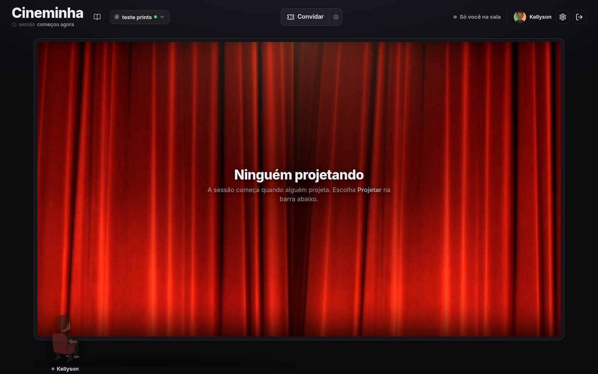
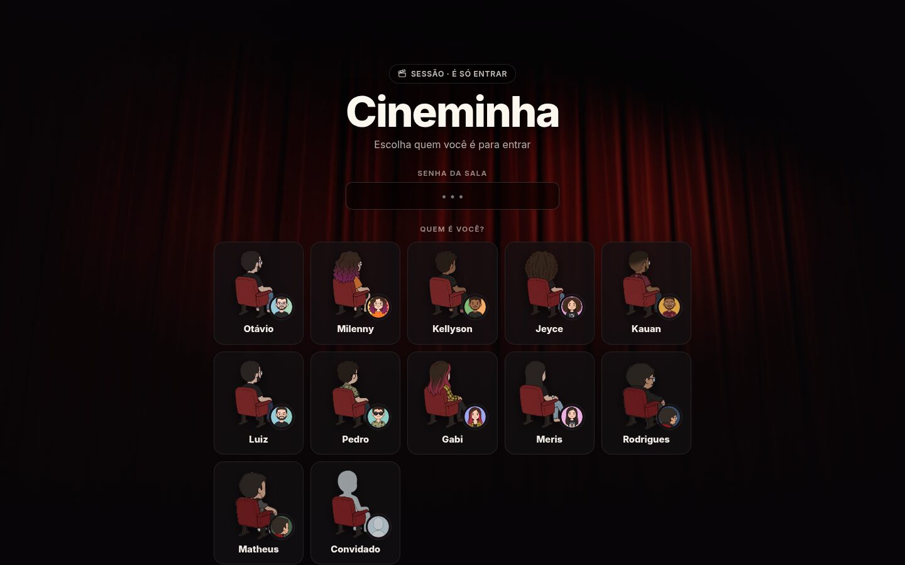
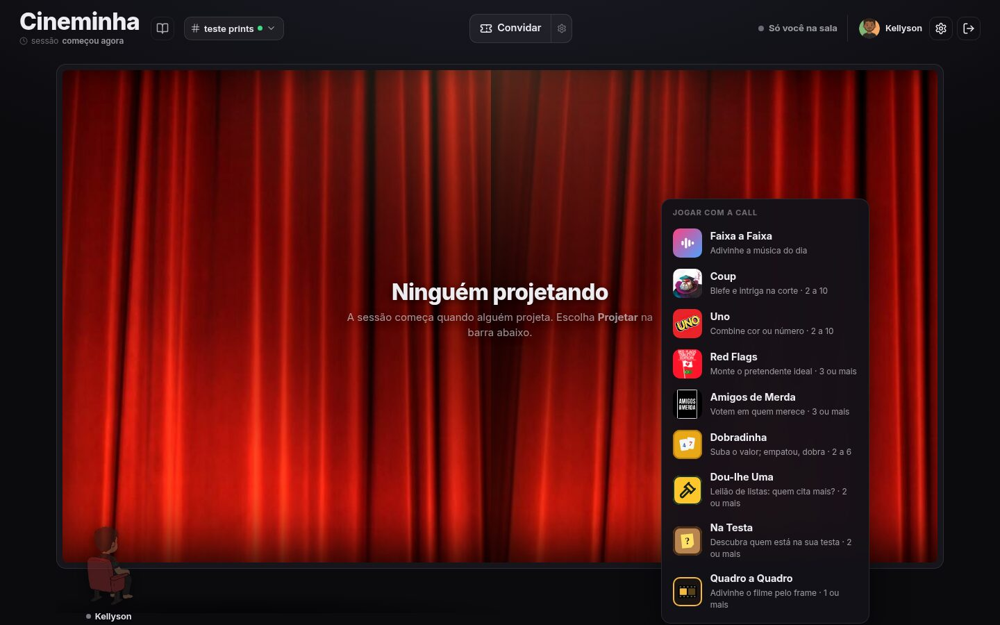
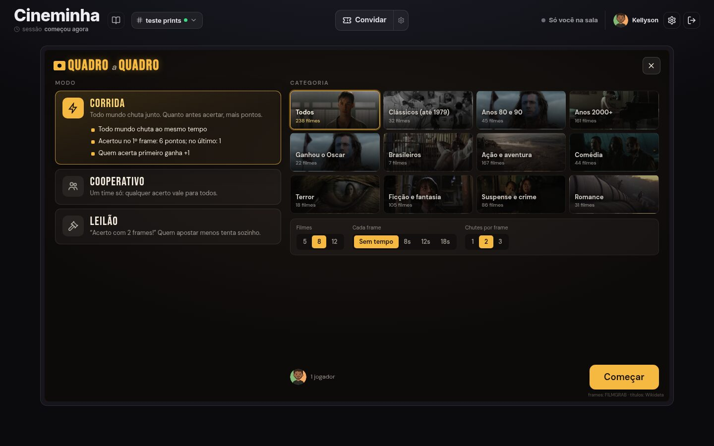
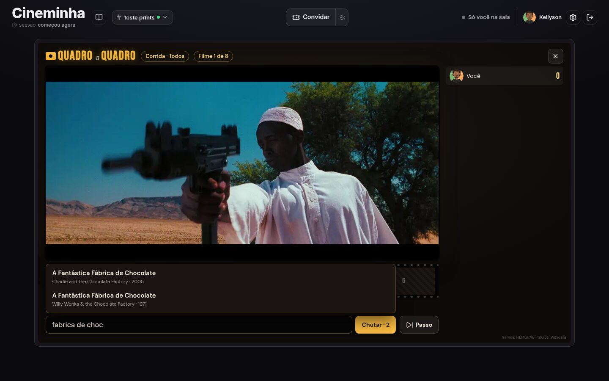

<p align="center"></p>

<p align="center">
  <a href="https://cineminha-boo.vercel.app"><b>Abrir no navegador</b></a> ·
  <a href="https://github.com/kellyson71/cineminha/releases/latest"><b>Baixar o app</b></a> ·
  <a href="https://github.com/kellyson71/cineminha/releases">Todas as versões</a>
</p>

<p align="center">
  <a href="https://github.com/kellyson71/cineminha/releases/latest"></a>
  <a href="https://github.com/kellyson71/cineminha/actions/workflows/app.yml"></a>
  <a href="https://github.com/kellyson71/cineminha/releases"></a>
</p>

Um cinema pequeno para assistir filmes com os amigos: cada um projeta a tela com som, todos conversam
por voz e chat, sentam nas poltronas da sala e, no intervalo, jogam juntos. Vídeo e voz vão direto entre
os participantes (WebRTC), sem servidor de mídia.



## Baixar o app

O app desktop entra na mesma sala do site e faz o que o navegador não faz: som de um programa só,
qualquer formato de filme (ffmpeg), atalhos globais, mini player e continua na call minimizado.

| Sistema | Download |
|---|---|
| Windows | [Instalador](https://github.com/kellyson71/cineminha/releases/latest/download/Cineminha-instalador.exe) · [Portátil](https://github.com/kellyson71/cineminha/releases/latest/download/Cineminha-portatil.exe) |
| Linux (qualquer distro) | [AppImage](https://github.com/kellyson71/cineminha/releases/latest/download/Cineminha-linux.AppImage) |
| Arch / CachyOS / Manjaro | [.pacman](https://github.com/kellyson71/cineminha/releases/latest/download/cineminha-linux.pacman) — `sudo pacman -U cineminha-linux.pacman` |
| Ubuntu / Debian / Mint | [.deb](https://github.com/kellyson71/cineminha/releases/latest/download/cineminha-linux.deb) |
| Fedora / openSUSE | [.rpm](https://github.com/kellyson71/cineminha/releases/latest/download/cineminha-linux.rpm) |

Atalho curto: `cineminha-boo.vercel.app/baixar` (ou `/baixar/windows`, `/baixar/linux`, `/baixar/arch`).
O app se atualiza sozinho a cada versão nova.

## Telas

| Entrada | Jogos |
|---|---|
|  |  |
| **Quadro a Quadro** — escolha o modo | **Adivinhe o filme pelo frame** |
|  |  |

## Jogos

Faixa a Faixa, Coup, Uno, Red Flags, Amigos de Merda, Dobradinha, Dou-lhe Uma, Na Testa e Quadro a Quadro.
Todos rodam na call, com um host que decide as jogadas e os outros conectados direto a ele. Regras e
arquitetura em [JOGOS.md](JOGOS.md).

## Organização

```
public/        o site (HTML, CSS e JS sem build) — publicado na Vercel
  core/        protocolo P2P, lista de jogos e poltronas, compartilhado com o app
  jogos/       arte, sons e dados de cada jogo
api/           funções da Vercel (chat, convites, sessões, preferências) com Redis
app/           app desktop (Electron + React) — veja app/README.md
tools/         coletores de dados dos jogos, servidor local e MCP
docs/          marca, prints e documentação dos jogos
.github/       release automática do app
```

## Desenvolvimento

```sh
node tools/dev.mjs           # site em http://localhost:8790 (use ?sala=teste-algo)
cd app && npm run dev        # app desktop
```

### Lançar uma versão do app

```sh
cd app && npm run lancar     # 0.1.0 → 0.1.1 (ou: npm run lancar -- minor)
```

O script sobe a versão e faz o push. O GitHub Actions cria a tag e a release, compila Linux e Windows
e anexa os arquivos; os links acima passam a apontar para ela sozinhos.

## Marca

A logo é um **c** que vira poltrona, com o play sentado nela. Arquivos em [`docs/marca/`](docs/marca):
`icone.svg` (app e favicon), `simbolo.svg`, `simbolo-claro.svg` (fundos escuros) e `simbolo-mono.svg`.
Cores: vermelho `#e5484d`, creme `#fff4e6`, âmbar `#ffc23d`.
